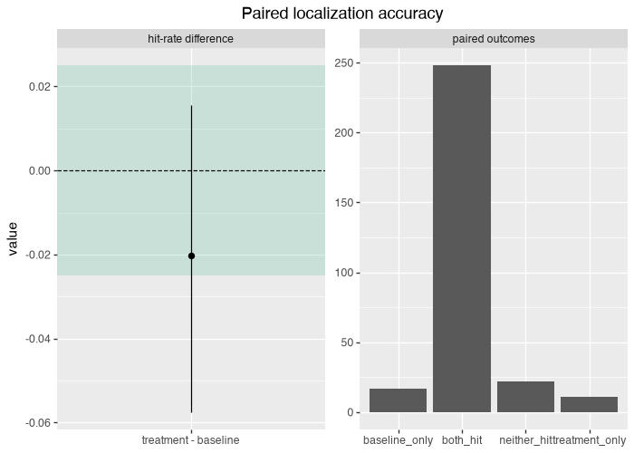
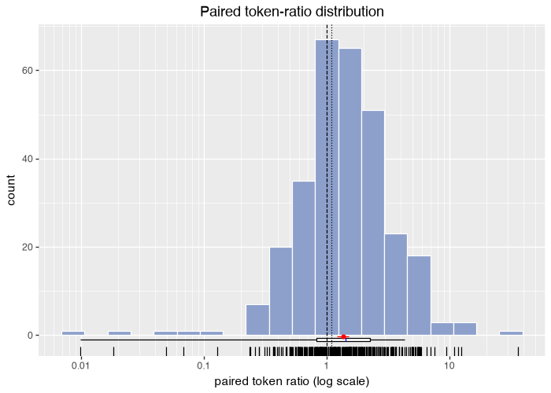
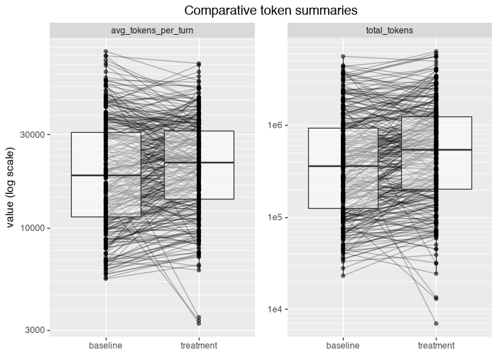
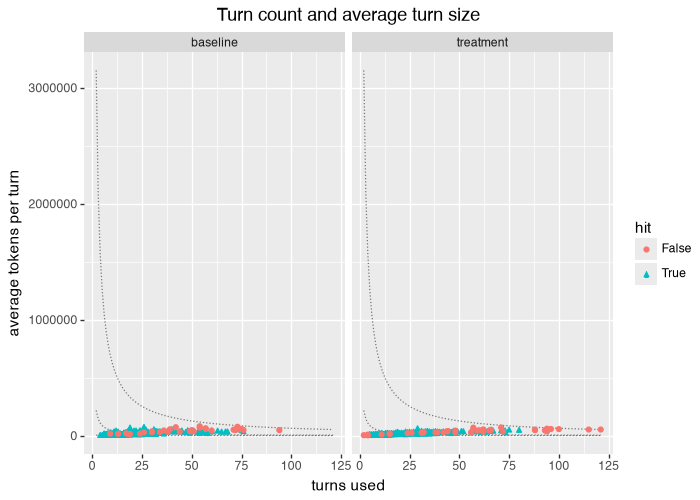

# eval-localization paired report

## Decision criteria

- criteria version: `2026-09-11-reference-boundaries`
- primary cost metric: `total_tokens`
- accuracy reference boundary: 0.025 (percentage points of any-gold-file hit rate)
- token-use reference boundary: 0.1 (proportional, so a ratio boundary of 1 + this value)
- confidence level (one-sided): 0.95
- attempts per cell: 1
- planned pairs: 300; this report covers 298, **2 short of the pre-registered plan**
- failure policy: {'agent_failure': 'scored as an outcome, counted as a miss', 'infra_failure': 'instance excluded when no usable attempt exists in an arm', 'attempt_selection': 'latest usable attempt represents the cell'}

The report estimates the accuracy and token-use effects and evaluates the registered claims independently beside them.
It issues no combined verdict across the two axes.

## Arm summaries

| metric         | baseline mean | baseline median | treatment mean | treatment median |
| -------------- | ------------- | --------------- | -------------- | ---------------- |
| total_tokens   | 747473.493    | 359061.500      | 949001.198     | 537452.000       |
| total_cost_usd | 3.097         | 1.630           | 3.888          | 2.507            |
| total_steps    | 24.023        | 18.000          | 30.027         | 24.000           |
| wall_clock_s   | 1501.567      | 1006.791        | 1704.893       | 1301.235         |
| reward         | 0.629         | 0.667           | 0.578          | 0.667            |
| precision      | 0.752         | 1.000           | 0.681          | 1.000            |
| recall         | 0.627         | 0.500           | 0.600          | 0.500            |
| f1             | 0.629         | 0.667           | 0.578          | 0.667            |
| any_gold_hit   | 0.889         | 1.000           | 0.869          | 1.000            |
| uptake_count   | 0.000         | 0.000           | 19.517         | 15.000           |
| search_count   | 10.779        | 8.500           | 6.678          | 4.000            |

## Paired effect estimates (intent-to-treat)

- accuracy: paired hit-rate difference lambda = -0.020 (treatment - baseline), two-sided 95% score interval [-0.057, 0.016], discordant pairs b = 11, c = 17, n = 298
- token use on `total_tokens`: geometric mean paired ratio = 1.36x (mean paired log ratio theta = 0.305), two-sided 95% bootstrap interval [1.22x, 1.50x], n = 298 pairs
- every pair counts regardless of c10r uptake; agent failures score as outcomes.

Both estimates are reported whether or not any registered claim below is supported.

## Paired accuracy outcome table

| outcome            | count |
| ------------------ | ----- |
| both hit           | 248   |
| treatment only hit | 11    |
| baseline only hit  | 17    |
| neither hit        | 22    |

## Token ratio distribution

Three summaries of the same paired ratios, each answering a different question.

| summary                                | value | question answered                                                        |
| -------------------------------------- | ----- | ------------------------------------------------------------------------ |
| mean paired log ratio (geometric mean) | 1.36x | proportional change per trajectory, equal weight per issue               |
| median paired ratio                    | 1.43x | what happened on the middle issue                                        |
| ratio of total tokens                  | 1.27x | billable volume for this sampled workload, large trajectories weigh more |

## Paired deltas

| instance                                                  | total_tokens delta | hit delta | baseline state | treatment state |
| --------------------------------------------------------- | ------------------ | --------- | -------------- | --------------- |
| Aider-AI\_\_aider-3806                                    | 1213066            | +0        | completed      | completed       |
| Kozea\_\_Radicale-1766                                    | -709676            | +0        | completed      | completed       |
| Textualize\_\_textual-5743                                | 685618             | +0        | completed      | completed       |
| ag2ai\_\_faststream-1796                                  | -848658            | +0        | completed      | completed       |
| ag2ai\_\_faststream-2170                                  | 1219791            | +0        | completed      | completed       |
| aiogram\_\_aiogram-1575                                   | 869246             | +0        | completed      | completed       |
| aiogram\_\_aiogram-1670                                   | 15867              | +0        | completed      | completed       |
| aiogram\_\_aiogram-1674                                   | 125864             | +0        | completed      | completed       |
| amoffat\_\_sh-750                                         | 9068               | +0        | completed      | completed       |
| apify\_\_crawlee-python-1181                              | 35641              | +0        | completed      | completed       |
| arviz-devs\_\_arviz-2408                                  | 55973              | +0        | completed      | completed       |
| aws-cloudformation\_\_cfn-lint-3475                       | 863935             | +0        | completed      | completed       |
| aws-cloudformation\_\_cfn-lint-3501                       | 1460032            | -1        | completed      | agent-failure   |
| aws-cloudformation\_\_cfn-lint-3557                       | 1188430            | +1        | completed      | completed       |
| aws-cloudformation\_\_cfn-lint-3629                       | -967497            | +0        | agent-failure  | completed       |
| aws-cloudformation\_\_cfn-lint-3650                       | -250297            | +0        | completed      | completed       |
| aws-cloudformation\_\_cfn-lint-3653                       | -441423            | +0        | completed      | completed       |
| aws-cloudformation\_\_cfn-lint-3659                       | -40533             | +0        | completed      | completed       |
| aws-cloudformation\_\_cfn-lint-3663                       | 31574              | -1        | completed      | completed       |
| aws-cloudformation\_\_cfn-lint-3684                       | 995513             | +0        | completed      | completed       |
| aws-cloudformation\_\_cfn-lint-3700                       | -444808            | -1        | completed      | agent-failure   |
| aws-cloudformation\_\_cfn-lint-3707                       | 1657648            | +0        | completed      | completed       |
| aws-cloudformation\_\_cfn-lint-3764                       | 134043             | +0        | completed      | completed       |
| aws-cloudformation\_\_cfn-lint-3767                       | 221399             | +0        | completed      | completed       |
| aws-cloudformation\_\_cfn-lint-3768                       | 990597             | +0        | completed      | completed       |
| aws-cloudformation\_\_cfn-lint-3817                       | -638696            | -1        | completed      | agent-failure   |
| aws-cloudformation\_\_cfn-lint-3821                       | 86823              | +0        | completed      | completed       |
| aws-cloudformation\_\_cfn-lint-3854                       | 415724             | +0        | completed      | completed       |
| aws-cloudformation\_\_cfn-lint-3855                       | 2072631            | +0        | completed      | completed       |
| aws-cloudformation\_\_cfn-lint-3856                       | 111454             | +0        | completed      | completed       |
| aws-cloudformation\_\_cfn-lint-3861                       | -845963            | +1        | completed      | completed       |
| aws-cloudformation\_\_cfn-lint-3866                       | -39698             | +0        | completed      | completed       |
| aws-cloudformation\_\_cfn-lint-3908                       | 2194883            | +0        | agent-failure  | agent-failure   |
| aws-cloudformation\_\_cfn-lint-3931                       | 403259             | +0        | completed      | completed       |
| aws-cloudformation\_\_cfn-lint-3947                       | -2689872           | +0        | completed      | completed       |
| aws-cloudformation\_\_cfn-lint-3972                       | 1899757            | +0        | completed      | agent-failure   |
| aws-cloudformation\_\_cfn-lint-3981                       | -1208694           | +1        | agent-failure  | completed       |
| aws-cloudformation\_\_cfn-lint-4002                       | 18747              | +0        | completed      | completed       |
| aws-cloudformation\_\_cfn-lint-4023                       | 916504             | +0        | completed      | completed       |
| beancount\_\_beancount-931                                | -3891              | +0        | completed      | completed       |
| beetbox\_\_beets-5437                                     | -87602             | -1        | completed      | completed       |
| beetbox\_\_beets-5457                                     | 321312             | +0        | completed      | completed       |
| beetbox\_\_beets-5495                                     | -45540             | +0        | completed      | completed       |
| beetbox\_\_beets-5561                                     | 109166             | +0        | completed      | completed       |
| beetbox\_\_beets-5682                                     | 2141248            | +0        | completed      | completed       |
| beeware\_\_briefcase-2035                                 | 49161              | +0        | completed      | completed       |
| beeware\_\_briefcase-2088                                 | 3536               | +0        | completed      | completed       |
| beeware\_\_briefcase-2125                                 | 681191             | +0        | completed      | completed       |
| beeware\_\_briefcase-2239                                 | 649971             | +0        | completed      | completed       |
| bridgecrewio\_\_checkov-6612                              | 1205343            | +0        | completed      | agent-failure   |
| bridgecrewio\_\_checkov-6657                              | -494366            | +0        | completed      | completed       |
| bridgecrewio\_\_checkov-6687                              | 575174             | +1        | completed      | completed       |
| bridgecrewio\_\_checkov-6893                              | 185486             | +0        | completed      | completed       |
| bridgecrewio\_\_checkov-6922                              | 258390             | +0        | completed      | completed       |
| bridgecrewio\_\_checkov-6933                              | 2552620            | +0        | completed      | completed       |
| bridgecrewio\_\_checkov-7002                              | -7259              | +0        | completed      | completed       |
| bridgecrewio\_\_checkov-7022                              | -16614             | +0        | completed      | completed       |
| bridgecrewio\_\_checkov-7124                              | -57160             | +0        | completed      | completed       |
| conan-io\_\_conan-16776                                   | 275330             | +0        | completed      | completed       |
| conan-io\_\_conan-16789                                   | 231372             | +0        | completed      | completed       |
| conan-io\_\_conan-16870                                   | 1623657            | +0        | completed      | agent-failure   |
| conan-io\_\_conan-16987                                   | 881                | +0        | completed      | completed       |
| conan-io\_\_conan-17123                                   | 83407              | +0        | completed      | completed       |
| conan-io\_\_conan-17326                                   | 27471              | +0        | completed      | completed       |
| conan-io\_\_conan-17382                                   | 166452             | +0        | completed      | completed       |
| conan-io\_\_conan-17387                                   | -128010            | +0        | completed      | completed       |
| conan-io\_\_conan-17781                                   | 325248             | +0        | completed      | completed       |
| conan-io\_\_conan-17863                                   | 297795             | +0        | completed      | completed       |
| conan-io\_\_conan-17877                                   | -170669            | +0        | completed      | completed       |
| conan-io\_\_conan-17923                                   | 246806             | +0        | completed      | completed       |
| conan-io\_\_conan-18037                                   | -102778            | +0        | completed      | completed       |
| conan-io\_\_conan-18089                                   | 46784              | +0        | completed      | completed       |
| conan-io\_\_conan-18153                                   | -514863            | -1        | completed      | agent-failure   |
| cyclotruc\_\_gitingest-115                                | -28505             | +0        | completed      | completed       |
| deepset-ai\_\_haystack-8609                               | 46082              | +0        | completed      | completed       |
| deepset-ai\_\_haystack-8725                               | 675435             | +0        | completed      | completed       |
| deepset-ai\_\_haystack-8973                               | 18921              | +0        | completed      | completed       |
| deepset-ai\_\_haystack-9026                               | -188255            | +0        | completed      | completed       |
| deepset-ai\_\_haystack-9218                               | 107017             | +0        | completed      | completed       |
| deepset-ai\_\_haystack-9230                               | -42622             | +0        | completed      | completed       |
| deepset-ai\_\_haystack-9242                               | -250716            | +0        | completed      | completed       |
| delgan\_\_loguru-1236                                     | 39416              | +0        | completed      | completed       |
| delgan\_\_loguru-1240                                     | -42570             | +0        | completed      | completed       |
| delgan\_\_loguru-1297                                     | -24075             | +0        | completed      | completed       |
| dynaconf\_\_dynaconf-1241                                 | 491048             | +0        | completed      | completed       |
| encode\_\_starlette-2697                                  | 66175              | +0        | completed      | completed       |
| encode\_\_starlette-2812                                  | -780641            | +0        | completed      | completed       |
| falconry\_\_falcon-2248                                   | 70124              | +0        | completed      | completed       |
| falconry\_\_falcon-2254                                   | 709288             | +0        | completed      | completed       |
| falconry\_\_falcon-2404                                   | 40640              | +0        | completed      | completed       |
| falconry\_\_falcon-2426                                   | 193013             | +0        | completed      | completed       |
| feature-engine\_\_feature_engine-856                      | 321218             | +0        | completed      | completed       |
| flexget\_\_flexget-4306                                   | -7112              | +0        | completed      | completed       |
| fonttools\_\_fonttools-3749                               | -90177             | +0        | completed      | completed       |
| fsspec\_\_filesystem_spec-1829                            | -76147             | +0        | completed      | completed       |
| geopandas\_\_geopandas-3419                               | 463120             | +0        | completed      | completed       |
| geopandas\_\_geopandas-3502                               | -52321             | +0        | completed      | completed       |
| huggingface\_\_datasets-7353                              | -24363             | +0        | completed      | completed       |
| huggingface\_\_datasets-7522                              | -167006            | +0        | completed      | completed       |
| huggingface\_\_smolagents-226                             | -1225              | +0        | completed      | completed       |
| huggingface\_\_smolagents-285                             | 39834              | +0        | completed      | completed       |
| icloud-photos-downloader\_\_icloud_photos_downloader-1082 | 219407             | +0        | completed      | completed       |
| instructlab\_\_instructlab-2236                           | 754202             | +0        | completed      | completed       |
| instructlab\_\_instructlab-2540                           | 310730             | +0        | completed      | completed       |
| instructlab\_\_instructlab-2789                           | -17688             | +0        | completed      | completed       |
| instructlab\_\_instructlab-2927                           | 733734             | +0        | completed      | completed       |
| ipython\_\_ipython-14503                                  | 689718             | +0        | completed      | completed       |
| ipython\_\_ipython-14555                                  | 839467             | +0        | completed      | completed       |
| ipython\_\_ipython-14693                                  | 8353               | +0        | completed      | completed       |
| ipython\_\_ipython-14838                                  | -1688828           | +0        | completed      | completed       |
| jarun\_\_buku-778                                         | 92606              | +0        | completed      | completed       |
| jlowin\_\_fastmcp-252                                     | 5914               | +0        | completed      | completed       |
| joke2k\_\_faker-2093                                      | 124905             | +0        | completed      | completed       |
| joke2k\_\_faker-2104                                      | 91235              | +0        | completed      | completed       |
| joke2k\_\_faker-2175                                      | 12622              | +0        | completed      | completed       |
| jupyterlab\_\_jupyter-ai-1125                             | 855423             | +0        | completed      | completed       |
| jupyterlab\_\_jupyter-ai-1294                             | 418066             | +0        | completed      | completed       |
| jupyterlab\_\_jupyter-ai-879                              | -919597            | +0        | completed      | completed       |
| jupyterlab\_\_jupyter-ai-962                              | 91141              | +0        | completed      | completed       |
| jupyterlab\_\_jupyter-ai-989                              | 139780             | +0        | completed      | completed       |
| kedro-org\_\_kedro-4075                                   | -510405            | +0        | completed      | completed       |
| kedro-org\_\_kedro-4540                                   | 60836              | +0        | completed      | completed       |
| keras-team\_\_keras-19973                                 | 63034              | +0        | completed      | completed       |
| keras-team\_\_keras-20079                                 | 815687             | +0        | completed      | completed       |
| keras-team\_\_keras-20120                                 | -62277             | +0        | completed      | completed       |
| keras-team\_\_keras-20123                                 | 569929             | -1        | completed      | agent-failure   |
| keras-team\_\_keras-20125                                 | -11643             | +0        | completed      | completed       |
| keras-team\_\_keras-20383                                 | -703129            | +0        | agent-failure  | completed       |
| keras-team\_\_keras-20396                                 | -2710872           | +1        | agent-failure  | completed       |
| keras-team\_\_keras-20609                                 | 1104330            | +0        | agent-failure  | agent-failure   |
| keras-team\_\_keras-20824                                 | -180362            | +0        | completed      | completed       |
| keras-team\_\_keras-20880                                 | -265618            | +0        | completed      | completed       |
| keras-team\_\_keras-21072                                 | 1108254            | +0        | agent-failure  | agent-failure   |
| koxudaxi\_\_datamodel-code-generator-2259                 | 636295             | +0        | completed      | completed       |
| koxudaxi\_\_datamodel-code-generator-2293                 | 1408589            | -1        | completed      | agent-failure   |
| koxudaxi\_\_datamodel-code-generator-2327                 | -1225706           | +1        | completed      | completed       |
| koxudaxi\_\_datamodel-code-generator-2334                 | 434108             | +0        | completed      | completed       |
| koxudaxi\_\_datamodel-code-generator-2349                 | -335202            | -1        | completed      | agent-failure   |
| koxudaxi\_\_datamodel-code-generator-2389                 | 855768             | +0        | completed      | completed       |
| kozea\_\_weasyprint-2231                                  | 437052             | +1        | completed      | completed       |
| kozea\_\_weasyprint-2300                                  | -502549            | +0        | completed      | completed       |
| kozea\_\_weasyprint-2301                                  | -1795105           | +0        | agent-failure  | agent-failure   |
| kozea\_\_weasyprint-2398                                  | 61679              | +0        | completed      | completed       |
| kozea\_\_weasyprint-2404                                  | 601077             | +0        | completed      | completed       |
| kozea\_\_weasyprint-2425                                  | 2759996            | +0        | agent-failure  | agent-failure   |
| kubernetes-client\_\_python-2303                          | -444184            | +0        | completed      | completed       |
| matplotlib\_\_matplotlib-28577                            | 2320052            | +0        | agent-failure  | agent-failure   |
| matplotlib\_\_matplotlib-28734                            | -263840            | +0        | completed      | completed       |
| matplotlib\_\_matplotlib-28881                            | -31078             | +0        | completed      | completed       |
| matplotlib\_\_matplotlib-29013                            | 308535             | +0        | completed      | completed       |
| matplotlib\_\_matplotlib-29388                            | -371341            | +0        | completed      | completed       |
| matplotlib\_\_matplotlib-29401                            | -259496            | -1        | completed      | completed       |
| matplotlib\_\_matplotlib-29503                            | 157698             | +0        | completed      | completed       |
| matplotlib\_\_matplotlib-29537                            | 37768              | +0        | completed      | completed       |
| matplotlib\_\_matplotlib-29696                            | -14987             | +0        | completed      | completed       |
| matplotlib\_\_matplotlib-29698                            | 61883              | +0        | completed      | completed       |
| matplotlib\_\_matplotlib-29719                            | -180120            | +0        | completed      | completed       |
| matplotlib\_\_matplotlib-29798                            | 1886419            | -1        | completed      | agent-failure   |
| matplotlib\_\_matplotlib-29873                            | 24708              | +0        | completed      | completed       |
| matplotlib\_\_matplotlib-29919                            | -1801160           | +1        | agent-failure  | completed       |
| meta-llama\_\_llama-stack-1105                            | 480151             | +0        | completed      | completed       |
| mikedh\_\_trimesh-2265                                    | 2534541            | +0        | completed      | completed       |
| mikedh\_\_trimesh-2397                                    | 43213              | +0        | completed      | completed       |
| networktocode\_\_ntc-templates-2118                       | 178828             | +0        | completed      | completed       |
| networkx\_\_networkx-8013                                 | 6611               | +0        | completed      | completed       |
| pallets\_\_flask-5626                                     | 532530             | +0        | completed      | completed       |
| patroni\_\_patroni-3119                                   | 630551             | +0        | completed      | completed       |
| patroni\_\_patroni-3148                                   | -304030            | +0        | completed      | completed       |
| patroni\_\_patroni-3198                                   | 443447             | +0        | completed      | completed       |
| patroni\_\_patroni-3338                                   | -1660651           | -1        | completed      | completed       |
| pdm-project\_\_pdm-3109                                   | 640397             | +0        | completed      | completed       |
| pdm-project\_\_pdm-3170                                   | 37435              | +0        | completed      | completed       |
| pdm-project\_\_pdm-3255                                   | -636974            | +0        | completed      | completed       |
| pdm-project\_\_pdm-3314                                   | 798524             | +0        | completed      | completed       |
| pdm-project\_\_pdm-3374                                   | -917195            | +0        | completed      | completed       |
| pdm-project\_\_pdm-3393                                   | 113099             | +0        | completed      | completed       |
| pdm-project\_\_pdm-3435                                   | 224036             | +0        | completed      | completed       |
| pdm-project\_\_pdm-3440                                   | -3699465           | +0        | agent-failure  | completed       |
| piskvorky\_\_smart_open-833                               | -107024            | +0        | completed      | completed       |
| privacyidea\_\_privacyidea-4223                           | -627889            | +0        | agent-failure  | agent-failure   |
| privacyidea\_\_privacyidea-4226                           | -1153149           | +0        | completed      | completed       |
| privacyidea\_\_privacyidea-4233                           | 41101              | +0        | completed      | completed       |
| privacyidea\_\_privacyidea-4247                           | 31119              | +0        | completed      | completed       |
| privacyidea\_\_privacyidea-4251                           | -122649            | +0        | completed      | completed       |
| projectmesa\_\_mesa-2463                                  | 35898              | +0        | completed      | completed       |
| projectmesa\_\_mesa-2523                                  | 162478             | +0        | completed      | completed       |
| projectmesa\_\_mesa-2632                                  | 35369              | +0        | completed      | completed       |
| pvlib\_\_pvlib-python-2227                                | 64383              | +0        | completed      | completed       |
| pvlib\_\_pvlib-python-2249                                | 341508             | +0        | completed      | completed       |
| pvlib\_\_pvlib-python-2286                                | -4495              | +0        | completed      | completed       |
| pvlib\_\_pvlib-python-2291                                | 151267             | +0        | completed      | completed       |
| pvlib\_\_pvlib-python-2347                                | -47638             | +0        | completed      | completed       |
| pwr-solaar\_\_solaar-2745                                 | -111097            | +0        | completed      | completed       |
| pybamm-team\_\_pybamm-4644                                | -10199             | +0        | completed      | completed       |
| pybamm-team\_\_pybamm-4865                                | 136195             | +0        | completed      | completed       |
| pydata\_\_xarray-10076                                    | 184575             | +0        | completed      | completed       |
| pydata\_\_xarray-10141                                    | -599144            | +0        | completed      | completed       |
| pydata\_\_xarray-9369                                     | 267459             | +0        | completed      | completed       |
| pydata\_\_xarray-9498                                     | -137601            | +0        | completed      | completed       |
| pydata\_\_xarray-9586                                     | 771350             | -1        | completed      | completed       |
| pydata\_\_xarray-9682                                     | 1276352            | +0        | completed      | completed       |
| pydata\_\_xarray-9760                                     | -258817            | +0        | completed      | completed       |
| pydata\_\_xarray-9765                                     | 89122              | +0        | completed      | completed       |
| pydata\_\_xarray-9971                                     | 53919              | +0        | completed      | completed       |
| pylint-dev\_\_pylint-10036                                | -111076            | +0        | completed      | completed       |
| pylint-dev\_\_pylint-10044                                | 148281             | +0        | completed      | completed       |
| pylint-dev\_\_pylint-10062                                | 2305839            | +0        | completed      | completed       |
| pylint-dev\_\_pylint-10097                                | 171323             | +0        | completed      | completed       |
| pylint-dev\_\_pylint-10141                                | -576401            | +0        | completed      | completed       |
| pylint-dev\_\_pylint-10225                                | 41077              | +0        | completed      | completed       |
| pylint-dev\_\_pylint-10246                                | -17998             | +0        | completed      | completed       |
| pylint-dev\_\_pylint-10250                                | 78076              | +0        | completed      | completed       |
| pylint-dev\_\_pylint-10300                                | -197020            | +0        | completed      | completed       |
| pylint-dev\_\_pylint-10328                                | -410482            | +0        | completed      | completed       |
| pylint-dev\_\_pylint-10344                                | 144997             | +1        | completed      | completed       |
| pylint-dev\_\_pylint-10350                                | 65414              | +0        | completed      | completed       |
| pylint-dev\_\_pylint-9771                                 | 489024             | +0        | completed      | completed       |
| pylint-dev\_\_pylint-9772                                 | 617223             | +0        | completed      | completed       |
| pylint-dev\_\_pylint-9844                                 | 442242             | +0        | completed      | completed       |
| pylint-dev\_\_pylint-9876                                 | -142911            | +0        | completed      | completed       |
| pylint-dev\_\_pylint-9882                                 | 188538             | +0        | completed      | completed       |
| pylint-dev\_\_pylint-9917                                 | 578391             | +0        | completed      | completed       |
| pylint-dev\_\_pylint-9990                                 | 2496355            | +0        | completed      | completed       |
| pypa\_\_twine-1188                                        | 138298             | +0        | completed      | completed       |
| pypsa\_\_pypsa-1091                                       | 854744             | +0        | completed      | completed       |
| pypsa\_\_pypsa-1172                                       | 2712620            | +0        | agent-failure  | agent-failure   |
| python-attrs\_\_attrs-1320                                | 1595232            | +0        | completed      | completed       |
| python-attrs\_\_attrs-1321                                | 1169633            | +0        | completed      | completed       |
| python-attrs\_\_attrs-1417                                | -1125522           | +0        | completed      | completed       |
| python-babel\_\_babel-1104                                | 540618             | +0        | completed      | completed       |
| python-babel\_\_babel-1120                                | -245919            | +0        | completed      | completed       |
| python-babel\_\_babel-1126                                | 378033             | +0        | completed      | completed       |
| python-babel\_\_babel-1132                                | -97750             | +0        | completed      | completed       |
| python-control\_\_python-control-1065                     | 82026              | +0        | completed      | completed       |
| python-control\_\_python-control-1096                     | -29464             | +0        | completed      | completed       |
| python-control\_\_python-control-1099                     | 34932              | +0        | completed      | completed       |
| python-control\_\_python-control-1104                     | 7454               | +0        | completed      | completed       |
| python-control\_\_python-control-1138                     | 112242             | +0        | completed      | completed       |
| python-control\_\_python-control-1145                     | 97607              | +0        | completed      | completed       |
| python-poetry\_\_poetry-10324                             | 320456             | +0        | completed      | completed       |
| python-poetry\_\_poetry-10353                             | 3136873            | +0        | completed      | completed       |
| python-telegram-bot\_\_python-telegram-bot-4626           | -4066              | +0        | completed      | completed       |
| python-telegram-bot\_\_python-telegram-bot-4673           | -667565            | +0        | completed      | completed       |
| pytorch\_\_torchtune-1697                                 | 21807              | +0        | completed      | completed       |
| pytorch\_\_torchtune-1806                                 | 593353             | +0        | completed      | completed       |
| pytorch\_\_torchtune-1832                                 | 34072              | +0        | completed      | completed       |
| pytorch\_\_torchtune-2139                                 | 24388              | +0        | completed      | completed       |
| pytorch\_\_torchtune-2342                                 | 95836              | +0        | completed      | completed       |
| pytorch\_\_torchtune-2560                                 | 70809              | +0        | completed      | completed       |
| pytransitions\_\_transitions-694                          | -37672             | +0        | completed      | completed       |
| qtile\_\_qtile-5100                                       | 758651             | +0        | completed      | completed       |
| reflex-dev\_\_reflex-3833                                 | 901306             | +0        | completed      | completed       |
| reflex-dev\_\_reflex-4087                                 | 220268             | +0        | completed      | completed       |
| reflex-dev\_\_reflex-4129                                 | -1043295           | +0        | completed      | completed       |
| reflex-dev\_\_reflex-4205                                 | 362784             | +0        | completed      | completed       |
| reflex-dev\_\_reflex-4256                                 | 834518             | +0        | completed      | completed       |
| reflex-dev\_\_reflex-4371                                 | 2820596            | -1        | completed      | agent-failure   |
| reflex-dev\_\_reflex-4510                                 | 76587              | -1        | completed      | agent-failure   |
| reflex-dev\_\_reflex-4620                                 | 3371476            | -1        | completed      | agent-failure   |
| reflex-dev\_\_reflex-4958                                 | 1700481            | +0        | completed      | completed       |
| run-llama\_\_llama_deploy-384                             | 14752              | +0        | completed      | completed       |
| run-llama\_\_llama_deploy-397                             | -445170            | +0        | completed      | completed       |
| sdv-dev\_\_SDV-2472                                       | -185650            | +0        | completed      | completed       |
| shapely\_\_shapely-2094                                   | 82506              | +0        | completed      | completed       |
| shapely\_\_shapely-2120                                   | -60977             | +0        | completed      | completed       |
| shapely\_\_shapely-2223                                   | 50267              | +0        | completed      | completed       |
| shapely\_\_shapely-2226                                   | 33131              | +0        | completed      | completed       |
| sissbruecker\_\_linkding-1045                             | 303459             | +0        | completed      | completed       |
| sissbruecker\_\_linkding-1051                             | 46914              | +0        | completed      | completed       |
| sissbruecker\_\_linkding-812                              | 100078             | +0        | completed      | completed       |
| sissbruecker\_\_linkding-820                              | -12555             | +0        | completed      | completed       |
| sooperset\_\_mcp-atlassian-299                            | -43683             | +0        | completed      | completed       |
| sphinx-doc\_\_sphinx-12598                                | -1044260           | +0        | completed      | completed       |
| sphinx-doc\_\_sphinx-12737                                | -1423956           | +1        | agent-failure  | completed       |
| sphinx-doc\_\_sphinx-12745                                | 852739             | +0        | completed      | completed       |
| sphinx-doc\_\_sphinx-13200                                | 1232849            | +0        | completed      | completed       |
| sphinx-doc\_\_sphinx-13253                                | 263247             | +0        | completed      | completed       |
| sphinx-doc\_\_sphinx-13318                                | 98626              | +0        | completed      | completed       |
| stanfordnlp\_\_dspy-1472                                  | 168384             | +0        | completed      | completed       |
| stanfordnlp\_\_dspy-1609                                  | -208711            | +1        | completed      | completed       |
| stanfordnlp\_\_dspy-1651                                  | -205372            | -1        | completed      | agent-failure   |
| stanfordnlp\_\_dspy-8053                                  | 164444             | +0        | completed      | completed       |
| streamlink\_\_streamlink-6205                             | -912251            | +0        | agent-failure  | agent-failure   |
| streamlink\_\_streamlink-6207                             | 861701             | +0        | completed      | completed       |
| streamlink\_\_streamlink-6242                             | 22229              | +0        | completed      | completed       |
| streamlink\_\_streamlink-6328                             | 3100542            | +0        | completed      | completed       |
| streamlink\_\_streamlink-6353                             | 18600              | +0        | completed      | completed       |
| streamlink\_\_streamlink-6397                             | 30384              | +0        | completed      | completed       |
| streamlink\_\_streamlink-6420                             | 42151              | +0        | completed      | completed       |
| streamlink\_\_streamlink-6479                             | -38520             | +0        | completed      | completed       |
| theoehrly\_\_fast-f1-699                                  | 1083068            | +0        | completed      | completed       |
| theoehrly\_\_fast-f1-701                                  | 49926              | +0        | completed      | completed       |
| urllib3\_\_urllib3-3441                                   | -833080            | +0        | completed      | completed       |
| wemake-services\_\_wemake-python-styleguide-3114          | 308980             | +0        | completed      | completed       |
| wemake-services\_\_wemake-python-styleguide-3117          | 301649             | +0        | completed      | completed       |
| wireservice\_\_csvkit-1281                                | -148206            | +0        | completed      | completed       |
| yt-dlp\_\_yt-dlp-11198                                    | -180610            | +0        | completed      | completed       |
| yt-dlp\_\_yt-dlp-12684                                    | 1025121            | +0        | completed      | completed       |

## Supporting measures

Exploratory: uptake, search displacement, and the failure summary below describe observed behavior.
They support no registered claim.

### Uptake and search displacement

- treatment uptake: mean 19.52 c10r calls/trial; 287/298 trials used c10r at least once
- search calls: baseline mean 10.78, treatment mean 6.68, displacement 4.10

### Cache engagement

Diagnostic, not a claim: flags a trial of 5+ turns that reported a cached share of prompt tokens at or below 1%, the signal that a frozen run has silently lost caching.
Caching does not change `total_tokens`, so it carries no registered claim.

| arm       | median cached share | flagged multi-turn near-zero trials | cache category absent |
| --------- | ------------------- | ----------------------------------- | --------------------- |
| baseline  | 8.4%                | 0/298                               | 0/298                 |
| treatment | 12.2%               | 0/298                               | 0/298                 |

### Failure summary

Terminal-state counts from the latest attempt of every (instance, arm) cell in this report.

| arm       | completed | agent-failure | infra-failure |
| --------- | --------- | ------------- | ------------- |
| baseline  | 283       | 16            | 1             |
| treatment | 274       | 24            | 2             |

## Exclusions

- qubvel-org\_\_segmentation_models.pytorch-1108: no usable baseline and treatment trial (infra-failure)
- sympy\_\_sympy-27395: no usable treatment trial (infra-failure)
- development-subset trials excluded from this report: 186

## Task-level analyses

Descriptive only: dividing the pairs by a task characteristic reduces precision, so no registered claim rides on any result below.

### Repository source-file count (descriptive; supports no formal claim)

- n = 298 pairs; the covariate is `log(source_file_count)`, kept continuous with no threshold derived from the results
- accuracy-delta slope per log-unit: 0.0105 (95% bootstrap interval [-0.0142, 0.0368])
- log-token-ratio slope per log-unit: 0.0125 (95% bootstrap interval [-0.0689, 0.1015])

### Source-file cue (descriptive; supports no formal claim)

| cue   | n pairs | accuracy lambda | accuracy 95% CI | token ratio | token 95% CI   |
| ----- | ------- | --------------- | --------------- | ----------- | -------------- |
| True  | 81      | 0.012           | [-0.062, 0.090] | 1.00x       | [0.79x, 1.24x] |
| False | 217     | -0.032          | [-0.078, 0.010] | 1.52x       | [1.36x, 1.70x] |

### Baseline trajectory length (descriptive; supports no formal claim)

- n = 298 pairs; the covariate is the baseline arm's `total_steps`, continuous
- accuracy-delta slope per step: 0.0004 (95% bootstrap interval [-0.0034, 0.0040])
- log-token-ratio slope per step: -0.0176 (95% bootstrap interval [-0.0224, -0.0131])

## Financial cost

- no price schedule supplied; financial cost not derived.

## Figures

### Paired localization accuracy

Left: the paired hit-rate difference lambda, treatment minus baseline, as a point with its two-sided 95% interval.
The dashed line is no difference; the shaded band is the reference boundary, plus or minus 0.025.
An interval wider than the band supports no claim in either direction.
Right: how many pairs fall in each of the four outcomes.
Only the discordant pairs, where one arm hit and the other missed, move lambda; the pairs where both arms agree contribute nothing to it.

### Paired token-ratio distribution

One paired ratio per instance, treatment tokens divided by baseline tokens, on a log x axis.
The dashed line at 1.00 is equal spend and the dotted line at 1.10 is the reference boundary; a point to the right of 1.00 is an instance where treatment spent more.
Below the histogram, the box spans the interquartile range with the median in blue, and the red point with its bar is the geometric mean with its 95% bootstrap interval.

### Comparative token summaries

Per-arm spread of total tokens and of average tokens per turn, both on a log y axis.
Each faint line joins the two arms of one instance, so a line sloping up is an instance where treatment spent more.
The box spans the interquartile range.

### Turn count and average turn size

Each point is one trial, placed by how many turns it used and how large its average turn was, with colour and shape marking whether it hit a gold file.
The dotted curves are constant total tokens, so a trial moving along one curve traded turns against turn size at equal spend, and a trial on a higher curve spent more.

## Registered claims

Each claim is evaluated independently against its pre-registered reference boundary.
Claims can overlap, and the accuracy and token-use results are never combined into one verdict.

| axis      | claim         | rule                                       | supported |
| --------- | ------------- | ------------------------------------------ | --------- |
| accuracy  | superior      | lower score bound above 0                  | False     |
| accuracy  | non-inferior  | lower score bound above -0.025             | False     |
| accuracy  | equivalent    | 90% score interval inside [-0.025, +0.025] | False     |
| accuracy  | harm          | upper score bound below 0                  | False     |
| accuracy  | material harm | upper score bound below -0.025             | False     |
| token use | superior      | upper bootstrap ratio bound below 1.00     | False     |
| token use | non-inferior  | upper bootstrap ratio bound below 1.10     | False     |
| token use | harm          | lower bootstrap ratio bound above 1.00     | True      |
| token use | material harm | lower bootstrap ratio bound above 1.10     | True      |

## Trajectory-level output

Per-trajectory measures and per-instance pairings needed to reproduce the estimates above, or to apply a different reference boundary, are emitted alongside this report.

## Superseded attempts

Each pair below had more than one usable attempt; the latest was used.

- ag2ai\_\_faststream-1796 (treatment): used ag2ai\_\_faststream-1796\_\_Tqqsuo7, replacing ag2ai\_\_faststream-1796\_\_zSL34H8
- ag2ai\_\_faststream-2170 (treatment): used ag2ai\_\_faststream-2170\_\_DvdHwES, replacing ag2ai\_\_faststream-2170\_\_XvdRmYP
- aiogram\_\_aiogram-1575 (treatment): used aiogram\_\_aiogram-1575\_\_Vkmtfby, replacing aiogram\_\_aiogram-1575\_\_3sNgiZ6
- aws-cloudformation\_\_cfn-lint-3475 (treatment): used aws-cloudformation\_\_cfn-lint-347\_\_2ibu7En, replacing aws-cloudformation\_\_cfn-lint-347\_\_SH7nSd7
- aws-cloudformation\_\_cfn-lint-3501 (treatment): used aws-cloudformation\_\_cfn-lint-350\_\_G9Gd2sY, replacing aws-cloudformation\_\_cfn-lint-350\_\_6vJsgPz
- aws-cloudformation\_\_cfn-lint-3629 (baseline): used aws-cloudformation\_\_cfn-lint-362\_\_cw7aoA9, replacing aws-cloudformation\_\_cfn-lint-362\_\_rmcAWSe
- aws-cloudformation\_\_cfn-lint-3629 (treatment): used aws-cloudformation\_\_cfn-lint-362\_\_sp8BPJ8, replacing aws-cloudformation\_\_cfn-lint-362\_\_pauDWF8
- aws-cloudformation\_\_cfn-lint-3653 (treatment): used aws-cloudformation\_\_cfn-lint-365\_\_9Eke4Y6, replacing aws-cloudformation\_\_cfn-lint-365\_\_3yedAbQ
- aws-cloudformation\_\_cfn-lint-3663 (treatment): used aws-cloudformation\_\_cfn-lint-366\_\_Tgy3x4C, replacing aws-cloudformation\_\_cfn-lint-366\_\_NSJ5hJA
- aws-cloudformation\_\_cfn-lint-3700 (baseline): used aws-cloudformation\_\_cfn-lint-370\_\_KdrEySG, replacing aws-cloudformation\_\_cfn-lint-370\_\_2gPEHio
- aws-cloudformation\_\_cfn-lint-3700 (treatment): used aws-cloudformation\_\_cfn-lint-370\_\_b88bXPq, replacing aws-cloudformation\_\_cfn-lint-370\_\_pCu2Ljj
- aws-cloudformation\_\_cfn-lint-3767 (treatment): used aws-cloudformation\_\_cfn-lint-376\_\_wupRvJk, replacing aws-cloudformation\_\_cfn-lint-376\_\_BgXxXFa
- aws-cloudformation\_\_cfn-lint-3768 (baseline): used aws-cloudformation\_\_cfn-lint-376\_\_NuhoBgy, replacing aws-cloudformation\_\_cfn-lint-376\_\_AAFE8C6
- aws-cloudformation\_\_cfn-lint-3768 (treatment): used aws-cloudformation\_\_cfn-lint-376\_\_LWqvN7j, replacing aws-cloudformation\_\_cfn-lint-376\_\_RfuJct4
- aws-cloudformation\_\_cfn-lint-3817 (baseline): used aws-cloudformation\_\_cfn-lint-381\_\_fTZZ69c, replacing aws-cloudformation\_\_cfn-lint-381\_\_6iBJiGS
- aws-cloudformation\_\_cfn-lint-3817 (treatment): used aws-cloudformation\_\_cfn-lint-381\_\_N7ZKXPg, replacing aws-cloudformation\_\_cfn-lint-381\_\_eMc8b3p
- aws-cloudformation\_\_cfn-lint-3908 (baseline): used aws-cloudformation\_\_cfn-lint-390\_\_BC9xEQs, replacing aws-cloudformation\_\_cfn-lint-390\_\_Yq8bYzm
- aws-cloudformation\_\_cfn-lint-3908 (treatment): used aws-cloudformation\_\_cfn-lint-390\_\_DrcQLxt, replacing aws-cloudformation\_\_cfn-lint-390\_\_iBuA8eM
- aws-cloudformation\_\_cfn-lint-3972 (baseline): used aws-cloudformation\_\_cfn-lint-397\_\_ve33WUZ, replacing aws-cloudformation\_\_cfn-lint-397\_\_mH9KLT7
- aws-cloudformation\_\_cfn-lint-3972 (treatment): used aws-cloudformation\_\_cfn-lint-397\_\_RSFHR53, replacing aws-cloudformation\_\_cfn-lint-397\_\_szUzHx5
- aws-cloudformation\_\_cfn-lint-3981 (baseline): used aws-cloudformation\_\_cfn-lint-398\_\_N2beA7N, replacing aws-cloudformation\_\_cfn-lint-398\_\_fmzry3V
- aws-cloudformation\_\_cfn-lint-3981 (treatment): used aws-cloudformation\_\_cfn-lint-398\_\_C82u3bs, replacing aws-cloudformation\_\_cfn-lint-398\_\_oeWdNDy
- beetbox\_\_beets-5682 (baseline): used beetbox\_\_beets-5682\_\_b8XmPW6, replacing beetbox\_\_beets-5682\_\_R4vw36m
- beetbox\_\_beets-5682 (treatment): used beetbox\_\_beets-5682\_\_9h52BGq, replacing beetbox\_\_beets-5682\_\_zkqDpTd
- bridgecrewio\_\_checkov-6612 (treatment): used bridgecrewio\_\_checkov-6612\_\_hHhUS2G, replacing bridgecrewio\_\_checkov-6612\_\_chn8XGj
- bridgecrewio\_\_checkov-6933 (treatment): used bridgecrewio\_\_checkov-6933\_\_acoGqUR, replacing bridgecrewio\_\_checkov-6933\_\_bW9HY8s
- conan-io\_\_conan-16870 (baseline): used conan-io\_\_conan-16870\_\_HMjewRt, replacing conan-io\_\_conan-16870\_\_sLKELbZ
- conan-io\_\_conan-16870 (treatment): used conan-io\_\_conan-16870\_\_tNLM83H, replacing conan-io\_\_conan-16870\_\_HqKYSj6
- conan-io\_\_conan-18153 (baseline): used conan-io\_\_conan-18153\_\_QGhHF8L, replacing conan-io\_\_conan-18153\_\_cZuLaWc
- conan-io\_\_conan-18153 (treatment): used conan-io\_\_conan-18153\_\_gjYvkN5, replacing conan-io\_\_conan-18153\_\_F3Bzuww
- encode\_\_starlette-2812 (treatment): used encode\_\_starlette-2812\_\_mwDSBrt, replacing encode\_\_starlette-2812\_\_f37yRoh
- jupyterlab\_\_jupyter-ai-1125 (treatment): used jupyterlab\_\_jupyter-ai-1125\_\_L7vomfo, replacing jupyterlab\_\_jupyter-ai-1125\_\_RTmwdni
- keras-team\_\_keras-20079 (baseline): used keras-team\_\_keras-20079\_\_AodKTaf, replacing keras-team\_\_keras-20079\_\_Zna6wr7
- keras-team\_\_keras-20123 (treatment): used keras-team\_\_keras-20123\_\_R3TJCcW, replacing keras-team\_\_keras-20123\_\_k3d2tAB
- keras-team\_\_keras-20383 (baseline): used keras-team\_\_keras-20383\_\_qbJfXV4, replacing keras-team\_\_keras-20383\_\_J3b53ok
- keras-team\_\_keras-20396 (baseline): used keras-team\_\_keras-20396\_\_Uk5LCFR, replacing keras-team\_\_keras-20396\_\_F5psG3L
- keras-team\_\_keras-20396 (treatment): used keras-team\_\_keras-20396\_\_wr4RfWj, replacing keras-team\_\_keras-20396\_\_LDdJeJS
- keras-team\_\_keras-20609 (baseline): used keras-team\_\_keras-20609\_\_DQ4hKcK, replacing keras-team\_\_keras-20609\_\_AapYp9n
- keras-team\_\_keras-20609 (treatment): used keras-team\_\_keras-20609\_\_bovQCgS, replacing keras-team\_\_keras-20609\_\_84Tp2HC
- keras-team\_\_keras-20880 (baseline): used keras-team\_\_keras-20880\_\_WJEdYXT, replacing keras-team\_\_keras-20880\_\_uQmmfuj
- keras-team\_\_keras-20880 (treatment): used keras-team\_\_keras-20880\_\_kz2g3Ux, replacing keras-team\_\_keras-20880\_\_6dAU4Xy
- keras-team\_\_keras-21072 (baseline): used keras-team\_\_keras-21072\_\_5Ve5xN9, replacing keras-team\_\_keras-21072\_\_jp4omFA
- keras-team\_\_keras-21072 (treatment): used keras-team\_\_keras-21072\_\_6QsSJft, replacing keras-team\_\_keras-21072\_\_7Daz3zg
- koxudaxi\_\_datamodel-code-generator-2293 (baseline): used koxudaxi\_\_datamodel-code-generat\_\_TPxdNe2, replacing koxudaxi\_\_datamodel-code-generat\_\_R8suHjn
- koxudaxi\_\_datamodel-code-generator-2293 (treatment): used koxudaxi\_\_datamodel-code-generat\_\_UrnCC6R, replacing koxudaxi\_\_datamodel-code-generat\_\_PwFJVHx
- koxudaxi\_\_datamodel-code-generator-2327 (baseline): used koxudaxi\_\_datamodel-code-generat\_\_YkbzL87, replacing koxudaxi\_\_datamodel-code-generat\_\_cLTrKwk
- koxudaxi\_\_datamodel-code-generator-2327 (treatment): used koxudaxi\_\_datamodel-code-generat\_\_VRvJJSx, replacing koxudaxi\_\_datamodel-code-generat\_\_Rx2euEs
- koxudaxi\_\_datamodel-code-generator-2349 (baseline): used koxudaxi\_\_datamodel-code-generat\_\_x3qbKpy, replacing koxudaxi\_\_datamodel-code-generat\_\_Y5eeVeA
- koxudaxi\_\_datamodel-code-generator-2349 (treatment): used koxudaxi\_\_datamodel-code-generat\_\_8gNbkQN, replacing koxudaxi\_\_datamodel-code-generat\_\_J8cpRUQ
- kozea\_\_weasyprint-2231 (treatment): used kozea\_\_weasyprint-2231\_\_xHncXUM, replacing kozea\_\_weasyprint-2231\_\_3qTpW2T
- kozea\_\_weasyprint-2301 (baseline): used kozea\_\_weasyprint-2301\_\_MAaUxDi, replacing kozea\_\_weasyprint-2301\_\_p45ffwx
- kozea\_\_weasyprint-2301 (treatment): used kozea\_\_weasyprint-2301\_\_VyAEpTp, replacing kozea\_\_weasyprint-2301\_\_bGJcerW
- kozea\_\_weasyprint-2425 (baseline): used kozea\_\_weasyprint-2425\_\_NQg9unp, replacing kozea\_\_weasyprint-2425\_\_gdpxGbg
- kozea\_\_weasyprint-2425 (treatment): used kozea\_\_weasyprint-2425\_\_Um5kZL6, replacing kozea\_\_weasyprint-2425\_\_xiNVnrQ
- matplotlib\_\_matplotlib-28577 (baseline): used matplotlib\_\_matplotlib-28577\_\_T6mtmeE, replacing matplotlib\_\_matplotlib-28577\_\_Y3VRDv7
- matplotlib\_\_matplotlib-28577 (treatment): used matplotlib\_\_matplotlib-28577\_\_T8zsG4B, replacing matplotlib\_\_matplotlib-28577\_\_UoWTteb
- matplotlib\_\_matplotlib-28734 (baseline): used matplotlib\_\_matplotlib-28734\_\_s9sHaXM, replacing matplotlib\_\_matplotlib-28734\_\_E6WovZc
- matplotlib\_\_matplotlib-28734 (treatment): used matplotlib\_\_matplotlib-28734\_\_gd9KJp6, replacing matplotlib\_\_matplotlib-28734\_\_gdbGHoH
- matplotlib\_\_matplotlib-29798 (treatment): used matplotlib\_\_matplotlib-29798\_\_eaSQeAB, replacing matplotlib\_\_matplotlib-29798\_\_GNQyZC8
- matplotlib\_\_matplotlib-29919 (baseline): used matplotlib\_\_matplotlib-29919\_\_AaBjirv, replacing matplotlib\_\_matplotlib-29919\_\_EXGsW4H
- patroni\_\_patroni-3148 (treatment): used patroni\_\_patroni-3148\_\_BZw9Fxd, replacing patroni\_\_patroni-3148\_\_AHTtT4r
- patroni\_\_patroni-3338 (baseline): used patroni\_\_patroni-3338\_\_FH2xJY3, replacing patroni\_\_patroni-3338\_\_5VdNRtQ
- pdm-project\_\_pdm-3374 (treatment): used pdm-project\_\_pdm-3374\_\_stXYbn8, replacing pdm-project\_\_pdm-3374\_\_HwVjJV9
- pdm-project\_\_pdm-3440 (baseline): used pdm-project\_\_pdm-3440\_\_8xC4LoE, replacing pdm-project\_\_pdm-3440\_\_D533Qt5
- pdm-project\_\_pdm-3440 (treatment): used pdm-project\_\_pdm-3440\_\_au8DQWj, replacing pdm-project\_\_pdm-3440\_\_JiWacv5
- privacyidea\_\_privacyidea-4223 (baseline): used privacyidea\_\_privacyidea-4223\_\_EWBdB2j, replacing privacyidea\_\_privacyidea-4223\_\_MEgiDVF
- privacyidea\_\_privacyidea-4223 (treatment): used privacyidea\_\_privacyidea-4223\_\_uzwerZG, replacing privacyidea\_\_privacyidea-4223\_\_c4MqgyN
- pydata\_\_xarray-9760 (treatment): used pydata\_\_xarray-9760\_\_6hu4d6T, replacing pydata\_\_xarray-9760\_\_VaxtWsX
- pylint-dev\_\_pylint-10062 (treatment): used pylint-dev\_\_pylint-10062\_\_2E92zRC, replacing pylint-dev\_\_pylint-10062\_\_7XTBNQL
- pylint-dev\_\_pylint-10344 (baseline): used pylint-dev\_\_pylint-10344\_\_C7dHq8n, replacing pylint-dev\_\_pylint-10344\_\_wH5eAdE
- pylint-dev\_\_pylint-9844 (treatment): used pylint-dev\_\_pylint-9844\_\_PS5sPmr, replacing pylint-dev\_\_pylint-9844\_\_LkcvrQv
- pylint-dev\_\_pylint-9990 (treatment): used pylint-dev\_\_pylint-9990\_\_drj8iMP, replacing pylint-dev\_\_pylint-9990\_\_6NsZQ9w
- pypsa\_\_pypsa-1172 (baseline): used pypsa\_\_pypsa-1172\_\_efQGBGM, replacing pypsa\_\_pypsa-1172\_\_RdcpTRH
- pypsa\_\_pypsa-1172 (treatment): used pypsa\_\_pypsa-1172\_\_cPywgkA, replacing pypsa\_\_pypsa-1172\_\_vUVrkbW
- python-attrs\_\_attrs-1417 (baseline): used python-attrs\_\_attrs-1417\_\_xmKH5Z3, replacing python-attrs\_\_attrs-1417\_\_xx8qnF3
- python-attrs\_\_attrs-1417 (treatment): used python-attrs\_\_attrs-1417\_\_LSNStQw, replacing python-attrs\_\_attrs-1417\_\_uRkdsEW
- pytorch\_\_torchtune-2560 (treatment): used pytorch\_\_torchtune-2560\_\_5BFKvDU, replacing pytorch\_\_torchtune-2560\_\_QEuSrXH
- qtile\_\_qtile-5100 (treatment): used qtile\_\_qtile-5100\_\_CqiQ8pL, replacing qtile\_\_qtile-5100\_\_RH29R4s
- reflex-dev\_\_reflex-3833 (baseline): used reflex-dev\_\_reflex-3833\_\_48ax58H, replacing reflex-dev\_\_reflex-3833\_\_cCf7bDP
- reflex-dev\_\_reflex-4129 (treatment): used reflex-dev\_\_reflex-4129\_\_hcC2yBG, replacing reflex-dev\_\_reflex-4129\_\_ABdH5d7
- reflex-dev\_\_reflex-4256 (treatment): used reflex-dev\_\_reflex-4256\_\_2ExiBWq, replacing reflex-dev\_\_reflex-4256\_\_zRspkAE
- reflex-dev\_\_reflex-4371 (treatment): used reflex-dev\_\_reflex-4371\_\_5Xdh2W4, replacing reflex-dev\_\_reflex-4371\_\_VudXRdd
- reflex-dev\_\_reflex-4510 (baseline): used reflex-dev\_\_reflex-4510\_\_GoCvJsX, replacing reflex-dev\_\_reflex-4510\_\_oGncFfR
- reflex-dev\_\_reflex-4510 (treatment): used reflex-dev\_\_reflex-4510\_\_fNTdY8H, replacing reflex-dev\_\_reflex-4510\_\_YPemqoV
- reflex-dev\_\_reflex-4620 (treatment): used reflex-dev\_\_reflex-4620\_\_EMthxqT, replacing reflex-dev\_\_reflex-4620\_\_BxGJrVa
- sdv-dev\_\_SDV-2472 (treatment): used sdv-dev\_\_SDV-2472\_\_Z69HtAF, replacing sdv-dev\_\_SDV-2472\_\_R6SXt7t
- sphinx-doc\_\_sphinx-12737 (baseline): used sphinx-doc\_\_sphinx-12737\_\_RyyK4UG, replacing sphinx-doc\_\_sphinx-12737\_\_BCTMFZd
- sphinx-doc\_\_sphinx-12737 (treatment): used sphinx-doc\_\_sphinx-12737\_\_JNcQvSN, replacing sphinx-doc\_\_sphinx-12737\_\_9QyQCVc
- sphinx-doc\_\_sphinx-13200 (baseline): used sphinx-doc\_\_sphinx-13200\_\_YE2KyUK, replacing sphinx-doc\_\_sphinx-13200\_\_rgNs5pu
- stanfordnlp\_\_dspy-1609 (baseline): used stanfordnlp\_\_dspy-1609\_\_mZxAV9P, replacing stanfordnlp\_\_dspy-1609\_\_faKwumG
- stanfordnlp\_\_dspy-1651 (treatment): used stanfordnlp\_\_dspy-1651\_\_bFhYbRN, replacing stanfordnlp\_\_dspy-1651\_\_wsxKRX9
- streamlink\_\_streamlink-6205 (baseline): used streamlink\_\_streamlink-6205\_\_gdxohyG, replacing streamlink\_\_streamlink-6205\_\_vgUyKAc
- streamlink\_\_streamlink-6205 (treatment): used streamlink\_\_streamlink-6205\_\_mbnTMbf, replacing streamlink\_\_streamlink-6205\_\_murtem5
- theoehrly\_\_fast-f1-699 (baseline): used theoehrly\_\_fast-f1-699\_\_iRBgsG6, replacing theoehrly\_\_fast-f1-699\_\_P8RLUVH
- urllib3\_\_urllib3-3441 (treatment): used urllib3\_\_urllib3-3441\_\_PYFPRnE, replacing urllib3\_\_urllib3-3441\_\_ANUoU7C
- yt-dlp\_\_yt-dlp-12684 (baseline): used yt-dlp\_\_yt-dlp-12684\_\_piyqU8W, replacing yt-dlp\_\_yt-dlp-12684\_\_ZoktfR9

## Caveats

- **Historical-fix file recovery, not localization correctness.**
  Accuracy grades recovery of the files the historical fix changed; a valid alternative localization scores as a miss, and this proxy error is not guaranteed symmetric across arms.
- **Contamination attenuates.**
  Models may localize memorized repositories from memory, which shrinks the measurable treatment effect; observed effects read as conservative.
- **The estimand is the treatment bundle.**
  Results attribute effects to c10r plus its instruction prompt, never to the tool alone.
